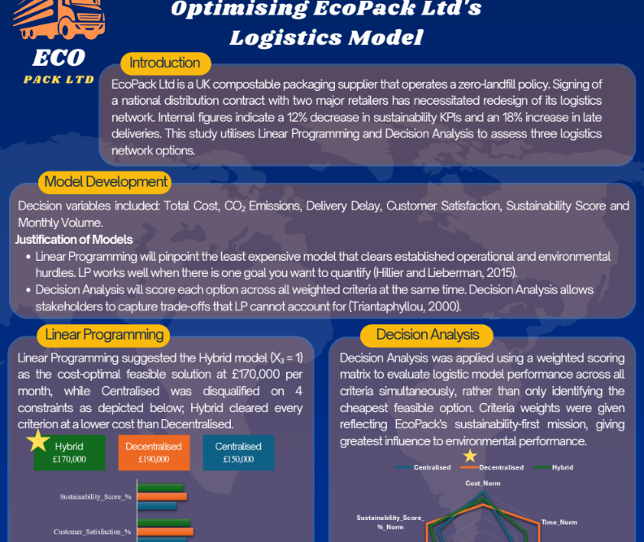

# ecopack-logistics-optimisation
Linear programming and decision analysis to choose a sustainable logistics setup (Excel Solver)

**Question:** Which of three logistics setups (Centralised, Decentralised, Hybrid) should EcoPack choose when balancing cost and sustainability?

**Tools:** Excel Solver (Linear Programming), Decision Analysis

## Approach
1. Built an LP model in Excel Solver to minimise [cost] subject to [capacity / demand constraints].
2. Scored each option with a decision analysis, then re-ran it with sustainability weighting.

## Results
- LP (cost only) recommended **Hybrid**.
- Decision analysis recommended **Decentralised**.
- Final recommendation: **Decentralised**, because it scored highest once sustainability and risk were weighted alongside cost, whereas the LP’s Hybrid result optimised for cost alone.

## Files
- `EcoPack_LP_Model.xlsx`: Solver model
- `EcoPack_LP_Model_Poster.pdf`: full A0 poster

## What I learned
I built and solved a constrained optimisation model in Excel Solver and tested how sensitive the recommendation was to the criteria weights. When two methods disagree, the analyst’s job is to make the trade-off clear so decision-makers can choose with confidence.
